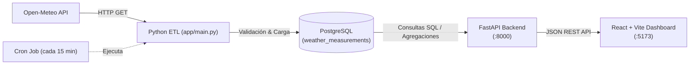

# Weather Data Pipeline & Analytics Dashboard

Pipeline ETL automatizado de datos meteorológicos de extremo a extremo, diseñado con arquitectura desacoplada para extracción periódica, procesamiento, persistencia en base de datos relacional, exposición mediante API REST y visualización en tiempo real mediante un dashboard web interactivo.

---

## 📋 Tabla de Contenidos

1. [Arquitectura del Sistema](#-arquitectura-del-sistema)
2. [Estructura del Proyecto](#-estructura-del-proyecto)
3. [Pipeline ETL (Extracción, Transformación, Carga)](#-pipeline-etl)
4. [Base de Datos (PostgreSQL)](#-base-de-datos-postgresql)
5. [Backend API (FastAPI)](#-backend-api-fastapi)
6. [Frontend Dashboard (React + Vite)](#-frontend-dashboard-react--vite)
7. [Requisitos Previos](#-requisitos-previos)
8. [Instalación y Configuración](#-instalación-y-configuración)
9. [Guía de Ejecución](#-guía-de-ejecución)
10. [Monitoreo y Logs](#-monitoreo-y-logs)

---

## 🏛 Arquitectura del Sistema

El flujo de información se encuentra completamente automatizado e integrado:

```text
Open-Meteo API (Datos en tiempo real)
          │
          ▼
    Python ETL
    ├── Ingesta (HTTP GET con Requests)
    ├── Transformación (Normalización de esquema)
    ├── Validación (Reglas de calidad y rangos físicos)
    └── Carga (Idempotente con ON CONFLICT)
          │
          ▼
PostgreSQL (Tabla weather_measurements)
          │
          ▼
FastAPI (REST API con CORS habilitado)
          │
          ▼
React + Vite Dashboard (Visualización sin mocks ni datos simulados)
```



---

## 📁 Estructura del Proyecto

```text
weather-data-pipeline/
├── app/
│   ├── ingestion/
│   │   └── weather_api.py       # Cliente HTTP para consumo de Open-Meteo API
│   ├── pipeline/
│   │   ├── transform.py         # Mapeo y tipado de variables meteorológicas
│   │   ├── validate.py          # Reglas de negocio y rangos válidos de datos
│   │   └── load.py              # Inserción idempotente en PostgreSQL
│   ├── api.py                   # API REST en FastAPI (CORS, endpoints y SQL queries)
│   └── main.py                  # Orquestador del ciclo ETL para ejecución batch
├── frontend/
│   ├── src/
│   │   ├── components/
│   │   │   ├── Header.jsx             # Encabezado con branding y botón de recarga
│   │   │   ├── WeatherCard.jsx        # Tarjetas para métricas puntuales
│   │   │   ├── SummaryCard.jsx        # Resumen de estadísticas agregadas
│   │   │   ├── TemperatureChart.jsx   # Gráfica temporal con Recharts
│   │   │   ├── MeasurementsTable.jsx  # Tabla interactiva con orden cronológico
│   │   │   ├── LoadingState.jsx       # Estado de carga ("Cargando datos...")
│   │   │   ├── ErrorState.jsx         # Estado de error con reintento
│   │   │   └── EmptyState.jsx         # Estado cuando no hay registros en BD
│   │   ├── services/
│   │   │   └── weatherApi.js          # Cliente centralizado de API (fetch)
│   │   ├── utils/
│   │   │   └── formatters.js          # Formateo de fechas y números
│   │   ├── App.jsx                    # Contenedor principal del Dashboard
│   │   ├── App.css                    # Estilos modernos, responsivos y minimalistas
│   │   ├── index.css                  # Variables CSS globales y reset
│   │   └── main.jsx                   # Punto de entrada de React
│   ├── .env                           # Configuración del frontend (VITE_API_URL)
│   ├── .env.example                   # Plantilla de variables de entorno
│   ├── package.json                   # Dependencias frontend (React, Recharts, Lucide)
│   └── vite.config.js                 # Configuración de compilador y bundler Vite
├── sql/
│   └── schema.sql               # DDL para creación de tablas e índices en PostgreSQL
├── pipeline.log                 # Registro histórico de ejecuciones del pipeline ETL
├── requirements.txt             # Dependencias del entorno de Python
└── README.md                    # Documentación técnica del proyecto
```

---

## ⚙️ Pipeline ETL

El pipeline se encuentra modularizado bajo el directorio `app/`:

### 1. Ingesta (`app/ingestion/weather_api.py`)
* Consume el endpoint público de pronóstico de **Open-Meteo**.
* Coordenadas geográficas configuradas: `Lat: 10.9685`, `Lon: -74.7813` (Barranquilla, Colombia).
* Parámetros solicitados:
  * `temperature_2m` (Temperatura a 2 metros en °C).
  * `relative_humidity_2m` (Humedad relativa en %).
  * `wind_speed_10m` (Velocidad del viento a 10 metros en km/h).
* Implementa control de excepciones de red y timeout de 10 segundos.

### 2. Transformación (`app/pipeline/transform.py`)
* Normaliza las llaves de la API externa a la nomenclatura utilizada por el modelo de datos relacional:
  * `time` ➔ `timestamp`
  * `temperature_2m` ➔ `temperature`
  * `relative_humidity_2m` ➔ `humidity`
  * `wind_speed_10m` ➔ `wind_speed`

### 3. Validación (`app/pipeline/validate.py`)
Asegura la calidad del dato antes de la persistencia mediante reglas físicas estrictas:
* Temperatura obligatoria y dentro del rango `[-50°C, 60°C]`.
* Humedad relativa obligatoria y dentro del rango `[0%, 100%]`.
* Velocidad del viento obligatoria y no negativa (`>= 0 km/h`).
* `timestamp` obligatorio y no nulo.

### 4. Carga (`app/pipeline/load.py`)
* Conexión a PostgreSQL mediante `psycopg2`.
* Inserción protegida contra duplicados:
  ```sql
  INSERT INTO weather_measurements (timestamp, temperature, humidity, wind_speed)
  VALUES (%s, %s, %s, %s)
  ON CONFLICT (timestamp) DO NOTHING;
  ```
* Garantiza **idempotencia**: el pipeline puede ejecutarse múltiples veces sobre el mismo rango horario sin generar mediciones redundantes.

### 5. Automatización con Cron
Una tarea en el programador de tareas del sistema (`crontab`) ejecuta el script cada 15 minutos:
```bash
*/15 * * * * /ruta/al/proyecto/venv/bin/python /ruta/al/proyecto/app/main.py >> /ruta/al/proyecto/pipeline.log 2>&1
```

---

## 🗄 Base de Datos (PostgreSQL)

La base de datos se denomina `weather_analytics` y almacena las series temporales meteorológicas.

### Esquema DDL (`sql/schema.sql`):
```sql
CREATE TABLE weather_measurements (
    id SERIAL PRIMARY KEY,
    timestamp TIMESTAMP NOT NULL UNIQUE,
    temperature DECIMAL(5,2) NOT NULL,
    humidity DECIMAL(5,2) NOT NULL,
    wind_speed DECIMAL(6,2) NOT NULL,
    created_at TIMESTAMP DEFAULT CURRENT_TIMESTAMP
);
```

* **`timestamp` (UNIQUE)**: Clave de tiempo de la medición, evita registros duplicados en el mismo punto temporal.
* **`created_at`**: Metadato de auditoría que registra el instante exacto en que el registro ingresó a la base de datos.

---

## 🚀 Backend API (FastAPI)

Implementado en [`app/api.py`](file:///home/cohorte5/Escritorio/weather-data-pipeline/app/api.py), expone los endpoints que alimentan al dashboard. Toda la información servida se extrae directamente de PostgreSQL.

### Configuración CORS
Permite solicitudes seguras desde el cliente web local:
* `http://localhost:5173`
* `http://127.0.0.1:5173`

### Endpoints Disponibles:

#### 1. Última Medición
```http
GET /weather/latest
```
Retorna el registro más reciente en la base de datos.
* **Respuesta 200 OK**:
  ```json
  {
    "timestamp": "2026-10-07T15:45:00",
    "temperature": 31.3,
    "humidity": 70.0,
    "wind_speed": 6.8
  }
  ```

#### 2. Resumen Estadístico
```http
GET /weather/summary
```
Ejecuta funciones de agregación SQL directamente en PostgreSQL (`AVG`, `MAX`, `MIN`, `COUNT`).
* **Respuesta 200 OK**:
  ```json
  {
    "avg_temperature": 28.9,
    "max_temperature": 31.3,
    "min_temperature": 26.6,
    "avg_humidity": 80.4,
    "avg_wind_speed": 8.0,
    "total_measurements": 14
  }
  ```

#### 3. Histórico de Mediciones
```http
GET /weather/history
```
Retorna la totalidad de mediciones ordenadas cronológicamente (`ORDER BY timestamp ASC`) para la construcción de series temporales y visualización tabular.
* **Respuesta 200 OK**:
  ```json
  [
    {
      "timestamp": "2026-10-07T11:45:00",
      "temperature": 26.6,
      "humidity": 94.0,
      "wind_speed": 8.9
    },
    ...
  ]
  ```

---

## 💻 Frontend Dashboard (React + Vite)

Ubicado en `frontend/`, implementa una interfaz moderna, limpia y minimalista sin datos mock ni placeholders ficticios.

### Características Principales:
* **Métricas en tiempo real**: Tarjetas individuales para Temperatura Actual (°C), Humedad relativa (%), Velocidad del viento (km/h) y Marca de tiempo de la última lectura.
* **Panel estadístico**: 6 métricas agregadas calculadas desde PostgreSQL.
* **Gráfica histórica**: Gráfica de línea responsiva construida con `recharts` que traza la evolución de la temperatura con tooltips detallados.
* **Tabla de mediciones**: Registro completo con formato legible de fechas, distintivos de color por tipo de métrica y botón interactivo para alternar orden ascendente o descendente.
* **Gestión de estados**:
  * **Loading**: Spinner visual con texto `"Cargando datos..."`.
  * **Error**: Alerta descriptiva `"No se pudieron cargar los datos."` con botón para reintentar la conexión.
  * **Empty State**: Aviso informativo `"No hay mediciones disponibles."` si la base de datos no tiene lecturas.
* **Botón de actualización**: Permite forzar la sincronización inmediata con el backend en cualquier momento.
* **Diseño visual profesional**: Cero emojis; utiliza exclusivamente iconos vectoriales SVG de la librería `lucide-react`.

---

## 📦 Requisitos Previos

* **Python** 3.10 o superior (recomendado 3.12+).
* **PostgreSQL** 14 o superior en ejecución local.
* **Node.js** 18 o superior y gestor de paquetes **npm**.

---

## 🛠 Instalación y Configuración

### 1. Clonar o ingresar al repositorio
```bash
cd ~/Escritorio/weather-data-pipeline
```

### 2. Configurar la Base de Datos
Crear la base de datos y ejecutar el script DDL:
```bash
# Iniciar sesión en PostgreSQL y crear base de datos
psql -U postgres -c "CREATE DATABASE weather_analytics;"

# Ejecutar el esquema SQL
psql -U postgres -d weather_analytics -f sql/schema.sql
```

> **Nota:** Verifica que las credenciales de conexión en `app/api.py` y `app/pipeline/load.py` coincidan con tu usuario y contraseña de PostgreSQL.

### 3. Configurar el Entorno Backend (Python)
```bash
# Crear el entorno virtual
python3 -m venv venv

# Activar el entorno virtual
source venv/bin/activate

# Instalar dependencias
pip install -r requirements.txt
```

### 4. Configurar el Frontend (React + Vite)
```bash
cd frontend

# Instalar dependencias
npm install

# Verificar o configurar variables de entorno
cp .env.example .env
```

Contenido de `frontend/.env`:
```env
VITE_API_URL=http://127.0.0.1:8000
```

---

## 🏃 Guía de Ejecución

Para operar el sistema completo en modo desarrollo, abre terminales independientes:

### Terminal 1: Iniciar el Backend (FastAPI)
```bash
cd ~/Escritorio/weather-data-pipeline
source venv/bin/activate
uvicorn app.api:app --reload
```
* API disponible en: `http://127.0.0.1:8000`
* Documentación Swagger interactiva: `http://127.0.0.1:8000/docs`

### Terminal 2: Iniciar el Frontend (Vite)
```bash
cd ~/Escritorio/weather-data-pipeline/frontend
npm run dev
```
* Dashboard disponible en: `http://localhost:5173`

### Ejecución manual del Pipeline ETL (Opcional)
Para consultar Open-Meteo e insertar inmediatamente una nueva medición:
```bash
cd ~/Escritorio/weather-data-pipeline
source venv/bin/activate
python app/main.py
```

---

## 📊 Monitoreo y Logs

* **Logs del ETL**: Toda la actividad del cron y de las ejecuciones batch se almacena en tiempo real en:
  ```bash
  tail -f pipeline.log
  ```
* **Consultas directas en PostgreSQL**:
  ```bash
  psql -U postgres -d weather_analytics -c "SELECT * FROM weather_measurements ORDER BY timestamp DESC LIMIT 5;"
  ```
* **Verificación de calidad del Frontend**:
  ```bash
  cd frontend
  npm run lint   # Validación con oxlint
  npm run build  # Compilación de producción
  ```
